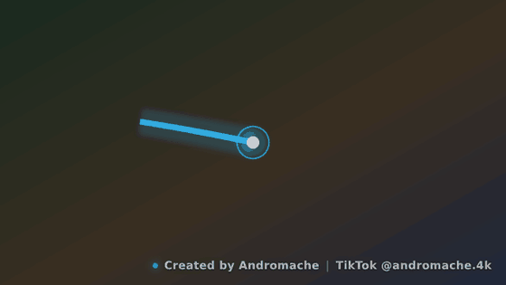
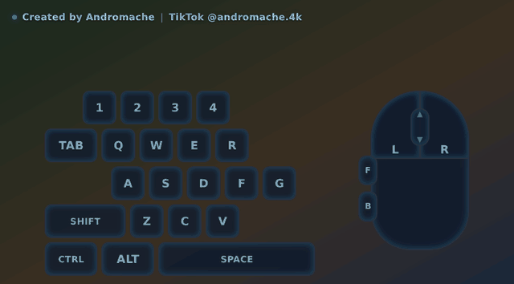
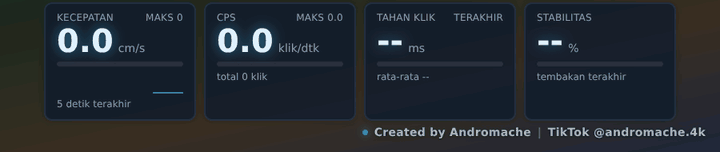
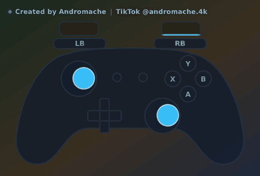
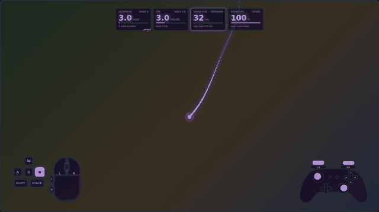
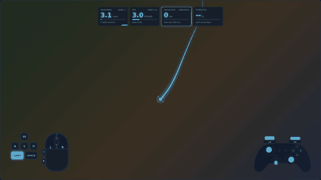

# AimTrail — overlay jejak mouse + tombol keyboard/mouse untuk live stream

> **Created by Andromache** · TikTok [@andromache.4k](https://www.tiktok.com/@andromache.4k) · v1.5.0

**Baru membuka? Baca panduan singkatnya:** `web/Panduan-AimTrail.pdf`, atau di aplikasi: menu tray → *Buka panduan* (`http://localhost:8765/manual.html`).

Saat kamu **menahan klik kiri** di game FPS, overlay menggambar jalur gerakan mouse
dengan ekor yang memudar lalu hilang. Saat klik tidak ditekan, overlay diam.
Bisa dipakai di OBS dan software streaming apa pun yang punya **Browser Source**
(Streamlabs Desktop, XSplit, vMix, Meld Studio, dll).

## Aplikasi `.exe` dengan system tray (disarankan)

Tidak perlu memasang Python. Cukup jalankan **`AimTrail.exe`**: ikon muncul di system tray
(dekat jam), panel terbuka di browser, dan tidak ada jendela konsol.

**Menu klik kanan pada ikon tray**

- Buka panel ekor mouse / panel keyboard + mouse (klik dua kali ikon = panel ekor mouse) dan **Buka panduan**
- Salin URL overlay (langsung tempel ke OBS)
- **Jalan otomatis saat Windows menyala**
- **Izinkan akses dari PC lain (LAN)** untuk setup dua PC, tanpa mengetik perintah
- Buka folder pengaturan, Tentang, Keluar

**Cara mendapatkan `AimTrail.exe`** (pilih salah satu)

1. **Build lokal:** di Windows, pasang Python 3.9+, lalu klik dua kali `build.bat` → hasil di `dist\AimTrail.exe` (ekstrak seluruh isi zip dulu; pertama kali butuh beberapa menit karena mengunduh pustaka)
2. **GitHub Actions:** unggah proyek ini ke repositori GitHub, lalu jalankan workflow *Build AimTrail.exe*
   (tab Actions) atau buat tag `v1.4.0`; file `.exe` jadi artifact / lampiran Release otomatis
3. **Installer (opsional):** setelah `build.bat`, buka `installer.iss` dengan [Inno Setup](https://jrsoftware.org/isinfo.php)
   → Compile → `AimTrail-Setup-1.5.0.exe` (ada pilihan ikon desktop dan jalan otomatis)

**Penyimpanan:** versi `.exe` menyimpan pengaturan di `%APPDATA%\AimTrail` (`config.json`, `keys.json`,
`settings.json`, `aimtrail.log`), jadi tetap aman saat `.exe` diganti dengan versi baru. Untuk memindahkan
pengaturan dari versi folder/Python, salin `config.json` dan `keys.json` ke folder itu.
Port bawaan 8765 bisa diubah lewat `settings.json` (`"port"`), lalu jalankan ulang.

Hanya satu AimTrail yang bisa berjalan; membuka yang kedua hanya membuka panel.

**Catatan antivirus / SmartScreen:** `.exe` buatan sendiri tidak bertanda tangan digital dan membaca input
keyboard/mouse global, jadi Windows SmartScreen atau antivirus tertentu bisa memberi peringatan atau salah mendeteksinya
(umum untuk aplikasi overlay input). Kode sumbernya terbuka di folder ini dan semua yang diteruskan hanya tombol di layout-mu.
Jika dibagikan ke banyak orang, tanda tangan kode (code signing) akan sangat membantu. Jangan mematikan antivirus; cukup
kecualikan file `AimTrail.exe` bila perlu.

## Pembaruan otomatis

AimTrail memeriksa **GitHub Releases** (saat start dan tiap 6 jam). Jika ada versi baru: muncul notifikasi tray, item
**Pembaruan** di menu tray, dan spanduk di panel. Klik **Pasang** → file diunduh, dicocokkan **SHA-256**, lalu `AimTrail.exe`
mengganti dirinya sendiri dan menyala ulang (overlay terputus beberapa detik). File lama disimpan sebagai `AimTrail.exe.old`,
pengaturan di `%APPDATA%\AimTrail` tidak berubah.

- Pilihan di menu tray > Pembaruan: *Periksa pembaruan sekarang*, *Periksa otomatis*, *Unduh otomatis di latar*
  (pemasangan tetap menunggu klikmu supaya tidak memutus siaran).
- `settings.json`: `update_repo` (bawaan `Althrus/aimtrail`), `auto_check`, `auto_download`.
- Aman: hanya HTTPS ke host GitHub, unduhan ditolak bila checksum tidak cocok, dan folder program yang tidak bisa ditulis
  (mis. Program Files) hanya membuka halaman rilis. Versi dari sumber Python tidak memasang sendiri.
- Versi sebelum 1.4.0 belum punya fitur ini: perbarui manual satu kali, setelahnya otomatis.

### Merilis versi baru (untuk pengembang)

1. **Sekali saja:** buat repositori **publik** `aimtrail` di GitHub (jika namanya berbeda, ubah `DEFAULT_REPO` di `updater.py`),
   lalu di *Settings > Actions > General > Workflow permissions* pilih **Read and write permissions**.
2. Unggah proyek (sekali): `git init`, `git add -A`, `git commit -m "AimTrail"`, `git branch -M main`,
   `git remote add origin https://github.com/Althrus/aimtrail.git`, `git push -u origin main`
3. **Tiap rilis:** `python tools/release.py 1.4.1` (menaikkan versi di semua file dan mencetak perintah `git commit`, `git tag v1.4.1`,
   `git push --tags`). GitHub Actions membangun `AimTrail.exe` + checksum dan menerbitkannya di Releases; pengguna otomatis diberi tahu.
   Workflow menolak rilis jika versi di kode tidak sama dengan tag.

## Watermark

Kedua overlay menampilkan watermark kecil **"Created by Andromache | TikTok @andromache.4k"**
(bawaan: kanan bawah, agak transparan). Posisi, opasitas, ukuran, jarak, dan on/off bisa diatur di grup
*Watermark* pada panel. Jika dua overlay dipakai bersamaan, watermark otomatis hanya tampil di satu overlay (tidak ganda).
Kredit juga ada di panel, menu Tentang, properti `.exe`, installer, dan manual.

## Empat overlay

| Overlay | URL Browser Source | Panel pengaturan |
|---|---|---|
| Ekor gerakan mouse | `http://localhost:8765/overlay.html` | `/panel.html` |
| Tombol keyboard + mouse | `http://localhost:8765/keys.html` | `/keys-panel.html` |
| Metrik live | `http://localhost:8765/metrics.html` | `/metrics-panel.html` |
| Controller (gamepad) | `http://localhost:8765/pad.html` | `/pad-panel.html` |

Masing-masing Browser Source terpisah, jadi bebas diletakkan dan diubah ukurannya sendiri-sendiri. Halaman **Tema** (`/tema.html`)
mengatur warna, huruf, bentuk, dan animasi untuk semuanya sekaligus.

## Demo

| Ekor mouse (titik terkunci di tengah) | Keyboard + mouse |
|---|---|
|  |  |

| Metrik live | Controller |
|---|---|
|  |  |

| Satu tema untuk semua overlay | Animasi masuk dan keluar |
|---|---|
|  |  |

Panduan singkat: [Bahasa Indonesia](web/Panduan-AimTrail.pdf) · [English](web/AimTrail-Guide.pdf) · English README: [README.en.md](README.en.md)

## Cara kerja

```
Mouse ──Raw Input──▶ server.py ──WebSocket──▶ overlay.html (Browser Source di OBS)
                          ▲                        ▲
                          └──── panel.html ────────┘  (atur tampilan, tersimpan di config.json)
```

Browser Source tidak bisa membaca mouse di luar halamannya, apalagi di dalam game
yang mengunci kursor. Karena itu ada `server.py` kecil yang membaca **Raw Input**
Windows (gerakan mentah, sama seperti yang dibaca game) dan meneruskannya ke overlay.

## Instalasi (Windows 10/11)

1. Pasang Python 3.9+ dari python.org (centang **Add python.exe to PATH**).
2. Ekstrak folder ini, lalu klik dua kali **`start.bat`** (menjalankan aplikasi tray dari sumber)
   (pertama kali akan memasang `aiohttp` otomatis).
3. Panel kontrol terbuka di browser: `http://localhost:8765/panel.html`

Opsi tambahan (juga berlaku untuk `AimTrail.exe`): `--port 9000`, `--rate 500` (frekuensi kirim data, Hz),
`--lan` (lihat bagian dua PC), `--minimized` (jangan buka panel saat mulai), `--simulate` (demo tanpa mouse asli),
`--no-tray` (mode konsol), `--data-dir FOLDER`.

## Dipasang di OBS

**Cara disarankan (anti-putus): file lokal**

1. Sources → **+** → **Browser**, lalu centang **Local file**.
2. Pilih file dari kartu **Anti-putus untuk OBS** di panel (tombol *Salin lokasi*), atau dari menu tray → *File OBS anti-putus*.
   Lokasinya `%APPDATA%\AimTrail\obs\AimTrail-Ekor-Mouse.html` dan `AimTrail-Keyboard-Mouse.html`.
3. Width/Height sama dengan kanvas OBS (mis. 1920 × 1080), FPS 60. Letakkan di atas Game Capture. Latar otomatis transparan.

Dengan file lokal, source **tidak perlu dihapus dan dibuat ulang** walau OBS dibuka sebelum AimTrail, AimTrail ditutup lalu dibuka lagi,
atau AimTrail diperbarui: file ini selalu bisa dimuat OBS, lalu menyambung ke AimTrail sendiri begitu AimTrail menyala. Port aktif
dibaca dari `endpoint.js` di folder yang sama (otomatis diperbarui), jadi mengganti port tidak memutus source.

**Cara alternatif: URL**

Tempel `http://localhost:8765/overlay.html` (ekor mouse) atau `http://localhost:8765/keys.html` (keyboard + mouse) pada Browser Source.
Kelemahannya: jika OBS dibuka *sebelum* AimTrail, halaman gagal dimuat dan OBS tidak mencoba lagi sendiri. Perbaiki dengan klik kanan
source → *Refresh*, atau centang *Refresh browser when scene becomes active*, atau pindah ke cara file lokal di atas.

Setiap perubahan di panel langsung terlihat di overlay, tanpa refresh. Untuk mengecek koneksi, tambahkan `?debug=1` di akhir URL overlay.

## Dua PC (game di PC A, OBS di PC B)

Di PC game aktifkan **Izinkan akses dari PC lain (LAN)** di menu tray (atau jalankan dengan `--lan`), lalu di PC OBS pakai
`http://IP-PC-GAME:8765/overlay.html` (IP ditampilkan di notifikasi tray dan menu Tentang).
Izinkan port 8765 di firewall. Siapa pun di jaringan lokal bisa mengubah
pengaturan, jadi pakai hanya di jaringan yang kamu percaya.

## Yang bisa di-customize (±60 opsi di panel)

- **Pemicu**: klik kiri / kanan / tengah / Mouse 4 / Mouse 5; mode tahan atau toggle; atau **mode selalu aktif**
  (ekor mengikuti mouse tanpa tombol apa pun; on/off lewat tombol *Selalu aktif* di panel, menu tray, atau `/api/always?on=toggle`)
- **Gerakan**: sensitivitas, balik X/Y, perilaku di tepi layar (**titik terkunci di tengah** / kamera ikut / tertahan / bebas),
  titik awal tiap tembakan, posisi titik pusat
- **Ekor**: lama bertahan, waktu hilang setelah klik dilepas, kurva fade, tebal pangkal-ujung,
  kehalusan lengkungan
- **Warna**: gradasi, satu warna, pelangi berputar, atau berdasarkan kecepatan gerakan
- **Glow**, **titik kepala**, **cincin berdenyut**, **gelombang saat klik**
- **Latar** opsional (transparan / grid / solid) untuk pengujian
- **Garis tepi overlay** opsional: warna, tebal, gaya (solid/putus-putus/titik/ganda), sudut membulat, jarak dari tepi layar, dan glow
- **8 preset**, ekspor/impor JSON untuk dibagikan

Panel punya area preview: tahan klik kiri dan gerakkan mouse di sana untuk mencoba,
atau tekan **Putar demo**.

## Metrik live

Empat kartu: **kecepatan mouse** (cm/dtk dengan DPI-mu atau hitungan mentah, plus grafik mini 5 detik), **klik per detik (CPS)** dengan puncak dan total,
**durasi tahan klik** (sekarang, terakhir, rata-rata 10 terakhir), dan **stabilitas bidikan**: seberapa lurus dan halus gerakan mouse
(jarak bersih dibagi panjang lintasan per jendela 1 detik, dihitung per kotak waktu 40 ms). 100% = halus; makin rendah = makin bolak-balik.
Ini indikator kasar, bukan skor resmi. Bisa dihitung hanya saat menahan klik (menembak) atau selalu. Susunan baris/kolom/kotak, bar, grafik,
tombol yang dihitung, sembunyi otomatis, dan tombol **Reset sesi** ada di panel Metrik.

## Controller (gamepad)

Membaca controller Xbox / kompatibel **XInput** langsung di server (tombol, trigger analog, dua stik, hingga 4 controller) dan menampilkannya sebagai
overlay: stik bergerak dengan jejak, trigger terisi sesuai tekanan, tombol menyala. Label Xbox / PlayStation / Nintendo, zona mati stik, warna
tombol A B X Y (warna Xbox atau ikut tema). Controller PlayStation / Switch Pro bisa lewat Steam Input atau DS4Windows. Hanya membaca, tidak mengirim
apa pun ke game.

## Tema bersama dan animasi

Halaman **Tema** mengatur satu tema untuk semua overlay: warna (aksen, gradasi, teks, latar kartu, garis tepi, glow), huruf, sudut membulat, serta
**animasi masuk/keluar** (naik, turun, dari samping, zoom, memudar; durasi; gaya gerak halus/memantul). Overlay **Metrik** dan **Controller** selalu
memakai tema; **Ekor mouse** dan **Keyboard + mouse** memakainya bila *Ikuti tema bersama* dicentang (tidak mengubah gaya lama kecuali kamu memilihnya).
8 preset tema, ekspor/impor JSON. Animasi dimainkan saat overlay muncul pertama kali, dan saat aktivitas kembali setelah sembunyi-otomatis.

## Overlay keyboard & mouse

Menampilkan tombol yang sedang kamu tekan dengan efek menyala dan memudar:
**1 2 3 4 · Q W E R · A S D F G · SHIFT Z C V · TAB · CTRL ALT SPACE** (21 tombol bawaan),
plus gambar mouse: klik kiri, kanan, tengah, scroll (panah naik/turun), dan tombol thumb depan/belakang.

Di `/keys-panel.html`:

- **Seret tombol di preview** untuk memindahkannya (ada snap); klik tombol untuk mengubah teks, posisi, dan ukurannya, atau menghapusnya
- **Tambah tombol** lain (A–Z, 0–9, F1–F12, panah, ESC, ENTER, CAPS, WIN, dll.)
- **4 preset layout** (FPS lengkap, WASD minimal, hanya mouse, hanya keyboard) dan **7 preset gaya**
- **Gaya**: Neon / Flat / Keycap 3D / Kaca, animasi tekan, kecepatan menyala & memudar, jenis huruf, semua warna, glow
- **Latar papan** opsional, skala & posisi seluruh papan, **sembunyi otomatis** saat tidak dipakai
- Ekspor/impor JSON; pengaturan tersimpan di `keys.json`

**Privasi:** server hanya meneruskan tombol yang *ada di layout kamu*. Ketikan lain (password, chat, dll.)
tidak pernah dikirim ke overlay, dan server tidak menyimpan atau mencatat riwayat tombol.

## Performa & kehalusan

Kalau terasa kurang responsif, cek berurutan:

1. **FPS Browser Source di OBS** — ini penyebab paling umum. Di properti Browser Source, centang
   *Use custom frame rate* lalu isi 60 (atau sama dengan FPS kanvas OBS). Pada banyak versi OBS
   defaultnya 30 FPS, sehingga gerakan terlihat patah.
2. Tambahkan `?debug=1` di URL overlay: pojok kiri atas menampilkan **FPS** dan jumlah data per detik.
   FPS harus ±60; data/dtk saat menggerakkan mouse harus ratusan.
3. OBS → Settings → Advanced → aktifkan **browser source hardware acceleration** (restart OBS).
4. Panel → **Performa & kehalusan** → turunkan **Kualitas render** ke *Seimbang* atau *Ringan*
   (glow dirender lebih kecil dan blur dikurangi), atau matikan Glow.
5. Sudah dioptimasi: server **tidur saat tidak ada input** (CPU ≈ 0%), mengirim 250 data/detik (`--rate`) dan tidak
   menaikkan prioritas proses (tidak mengganggu game); render bawaan *Seimbang*; overlay **berhenti menggambar saat diam**
   dan panel hanya menyentuh tampilan saat ada perubahan.

## Pemecahan masalah

| Gejala | Coba |
|---|---|
| Panel menulis "mode simulasi" | Bukan Windows atau Raw Input gagal; lihat `aimtrail.log` di folder pengaturan (menu tray → Buka folder pengaturan) |
| Pengaturan di panel (mis. garis tepi) tidak terlihat di OBS | Halaman lama masih ter-cache di OBS: klik kanan Browser Source → Properties → **Refresh cache of current page**. Setelah itu halaman memuat ulang sendiri tiap kali server di-restart dengan file baru |
| Setelah klik *Pasang*, AimTrail hilang dari tray dan tidak menyala sendiri | Versi baru sudah terpasang: buka `AimTrail.exe` lagi. Pembaruan dari versi sebelum 1.4.3 memang masih bisa begini (cara menyalakan ulang diperbaiki di 1.4.3); mulai 1.4.3 menyala otomatis, dan bila gagal AimTrail lama tetap berjalan serta memberi tahu. Detail ada di `aimtrail.log` |
| Source OBS kosong/error setelah OBS dibuka sebelum AimTrail (harus dihapus & dibuat ulang) | Pakai mode **Local file** (bagian *Dipasang di OBS*). Untuk source berupa URL: klik kanan source → Refresh |
| Overlay kosong di OBS | Buka URL di browser biasa dulu; tambahkan `?debug=1`; cek server masih berjalan |
| Tidak bereaksi saat main | Game mungkin berjalan sebagai Administrator → jalankan AimTrail (`AimTrail.exe`/`start.bat`) sebagai Administrator juga |
| Muncul pesan "Server gagal dijalankan di port 8765" | Port dipakai aplikasi lain. Ubah `"port"` di `settings.json`, jalankan ulang, dan sesuaikan URL di OBS |
| Ekor terlalu pendek/panjang untuk sensitivitas game | Atur **Sensitivitas** dan **Lama ekor bertahan** |
| Putus-putus di OBS | Naikkan FPS Browser Source ke 60 dan pastikan hardware acceleration browser source aktif |

## Catatan anti-cheat

Aplikasi ini hanya **membaca** input lewat API Raw Input standar Windows: tanpa hook,
tanpa injeksi ke game, tanpa membaca memori game. Meski begitu, kebijakan tiap anti-cheat
berbeda dan tidak bisa saya jamin; untuk game kompetitif, cek aturan resminya dulu.

## Struktur file

```
app.py             aplikasi tray (titik masuk .exe)
server.py          server input + web (Python, aiohttp)
icon.py            ikon tray & pembuat icon.ico
updater.py         pembaruan otomatis (GitHub Releases)
tools/release.py   naikkan versi + cetak perintah rilis
start.bat          peluncur dari sumber (Python)
build.bat          build AimTrail.exe (PyInstaller)
aimtrail.spec      konfigurasi PyInstaller (+ version_info.txt)
installer.iss      skrip installer Inno Setup (opsional)
.github/workflows  build .exe otomatis di GitHub Actions
web/overlay.html   ekor mouse (Browser Source)
<folder pengaturan>/obs/  file pemuat "Local file" untuk OBS (dibuat otomatis)
web/panel.html     panel ekor mouse + preview
web/trail.js       mesin render ekor
web/keys.html      overlay keyboard & mouse (Browser Source)
web/keys-panel.html panel keyboard & mouse + editor layout
web/keys.js        mesin tampilan tombol
web/panel.css      gaya panel
web/wm.js         watermark
web/theme.js, anim.js  tema bersama + animasi masuk/keluar
web/metrics.js, metrics.html, metrics-panel.html  metrik live
web/pad.js, pad.html, pad-panel.html  controller (gamepad)
web/tema.html       halaman Tema & animasi
web/nav.js          navigasi bersama panel
docs/*.gif          GIF demo (README)
README.en.md        README bahasa Inggris
web/manual.html, manual.en.html  panduan di dalam aplikasi (Indonesia / English)
web/Panduan-AimTrail.pdf, AimTrail-Guide.pdf  panduan PDF untuk dibagikan
tools/build_manual.py  pembuat manual (butuh `pip install reportlab`)
config.json        pengaturan ekor (dibuat otomatis)
keys.json          pengaturan keyboard & mouse (dibuat otomatis)
```

### Protokol WebSocket (`/ws`), bila ingin membuat overlay sendiri

- `GET /api/always?on=1|0|toggle` → nyalakan/matikan mode selalu aktif (cocok untuk Stream Deck / hotkey)
- `GET /api/status` → versi, sumber input, jumlah klien (untuk diagnosa)
- koneksi: `/ws?sub=trail|keys` (tanpa `sub` = semua event)
- server → klien: `{"t":"hello","config":{…},"kconfig":{…},"src":"rawinput","build":"…","keys":[vk…],"mask":n}`,
  `{"t":"config"|"kconfig","config":{…}}`, dan array event:
  `{"t":"m","dx":int,"dy":int,"d":ms}` (gerakan mentah), `{"t":"b","b":mask}` (tombol mouse; bit 1=kiri 2=kanan 4=tengah 8=Mouse4 16=Mouse5),
  `{"t":"k","k":vk,"d":1|0}` (keyboard, kode VK Windows), `{"t":"w","v":1|-1}` (scroll)
- klien → server: `{"t":"config"|"kconfig","config":{…}}` (`kconfig.watch` = daftar VK yang boleh diteruskan)
